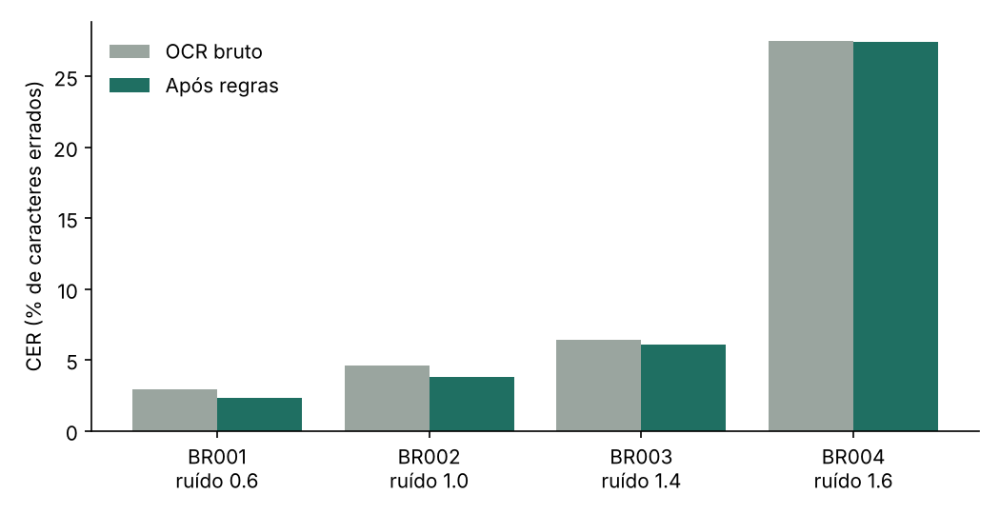

# Validação de texto extraído por OCR em documentos de patentes

**Pergunta:** quando um PDF escaneado passa por OCR, quanto do texto chega errado, que tipos de erro aparecem e quais podem ser corrigidos automaticamente sem risco?

Este projeto simula o fluxo de conferência de documentos técnicos: gera patentes de exemplo, "escaneia" com ruído, extrai o texto com OCR real (Tesseract, português) e valida o resultado contra o texto original, separando o que dá para **corrigir direto** do que precisa de **revisão humana**.

> Os quatro documentos são **patentes fictícias** escritas para o projeto, com temas de mineração e óleo e gás (testemunhos de sondagem, flotação de minério de ferro, piezômetros em barragens, perfis de poço). Não são documentos reais do INPI.

Portfólio: https://leticiacerqueira.github.io

## Ferramentas
Python · Tesseract OCR · PyMuPDF · Pillow/NumPy (simulação de scan) · RapidFuzz (distância de edição) · difflib · Matplotlib

## Etapas
| Script | O que faz |
|---|---|
| `src/01_gerar_documentos.py` | Cria os PDFs com título, resumo, reivindicações e figuras, e versões escaneadas com rotação, desfoque, ruído e perda de resolução em 4 níveis. |
| `src/02_ocr.py` | Roda o Tesseract (`-l por`) a 300 dpi, salva o texto e a confiança de cada palavra, e descarta páginas que só têm ruído. |
| `src/03_validar.py` | Aplica regras de correção seguras, alinha OCR e original palavra a palavra, mede CER e WER, classifica cada divergência e confere se todas as legendas de figura foram lidas em sequência. |
| `src/04_relatorio.py` | Gera `saida/relatorio.md` e o gráfico `saida/cer_por_documento.png`. |

### Regra de decisão
- **Corrigir direto:** palavra quebrada ou unida, maiúscula/minúscula, acentuação e trocas pequenas de caractere (até 2 letras) em palavras com confiança do OCR ≥ 60.
- **Revisar:** números, símbolos e unidades (um `m³` errado muda o sentido técnico), trechos inseridos ou omitidos e palavras de baixa confiança. A ideia é nunca "inventar" uma correção.

### Regras automáticas (aplicadas sem olhar o gabarito)
Unidades lidas errado (`m?` → `m³`, `um` → `µm`, `gh` → `g/t`, `º C` → `°C`), barra `|` lida no lugar do número 1, letra O entre dígitos, sinal ±, palavras hifenizadas na quebra de linha.
Durante o projeto, uma regra mais agressiva para a letra O transformou `SiO2` em `Si02`. Ela foi restringida para agir só **entre dois dígitos**, um exemplo de por que regra automática precisa ser testada contra o original.

## Resultados


| Documento | Ruído do scan | CER bruto | CER após regras | WER bruto | WER após regras |
|---|---:|---:|---:|---:|---:|
| BR001 | 0,6 | 2,9% | 2,3% | 8,7% | 5,2% |
| BR002 | 1,0 | 4,6% | 3,8% | 12,2% | 9,3% |
| BR003 | 1,4 | 6,4% | 6,1% | 23,8% | 22,5% |
| BR004 | 1,6 | 27,5% | 27,4% | 51,2% | 50,6% |

- Em scans bons, o OCR erra menos de 3% dos caracteres, e as regras derrubam o erro por palavra de 8,7% para 5,2%.
- **67 divergências** no total: 16 corrigíveis direto e 51 sinalizadas para revisão. Números, unidades e símbolos concentram os erros que mais importam em documento técnico (ex.: `P80` lido como `PBO`, `g/t` como `gh`, `m³` como `m?`).
- No documento mais degradado (BR004), mais da metade das palavras sai errada e a legenda da figura não foi lida. Nesse caso o certo é **escalar para revisão manual completa** em vez de corrigir palavra por palavra.

Detalhes em [`saida/relatorio.md`](saida/relatorio.md), [`saida/inconsistencias.csv`](saida/inconsistencias.csv) e [`saida/figuras.csv`](saida/figuras.csv).

**CER/WER:** porcentagem de caracteres/palavras que precisam ser trocados, inseridos ou apagados para o texto do OCR ficar igual ao original.

## Como rodar
```bash
sudo apt install tesseract-ocr tesseract-ocr-por
pip install pymupdf pillow numpy rapidfuzz unidecode matplotlib
python src/01_gerar_documentos.py
python src/02_ocr.py
python src/03_validar.py
python src/04_relatorio.py
```

## Autora
Leticia Santos Cerqueira · Analista de Dados · [LinkedIn](https://www.linkedin.com/in/leticiasantoscerqueira/)
